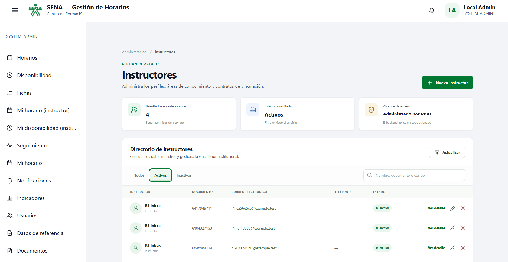

# R1: implementación y validación local

**Fecha:** 2026-10-20 · **Responsable:** José Stiven Perdomo Martínez

## Alcance

R1 añade outbox transaccional a los eventos de disponibilidad de instructores y matrícula de aprendices. El consumidor de IAM ya disponía de inbox por `event_id`, política de reintentos y DLQ; se añade reproducción manual de un mensaje. El cambio de infraestructura incorpora Kafka interno al Compose.

## Componentes

| Repositorio | Cambio |
|---|---|
| `design-software-actors-db-JS` | Tabla `actors_tracking.outbox_event`, índices, grants y rollback Liquibase. |
| `design-software-actors-service-JS` | Writer transaccional, despachador, backoff, operaciones de estado/replay y pruebas. |
| `design-software-docker-infra-JS` | Kafka 3.9.2 interno, volumen persistente, dependencia de Actors. |

## Comprobaciones ejecutadas

- Liquibase aplicó las dos migraciones nuevas en una base local aislada: total 27 cambiosets.
- `mvn test` en imagen R1 final: BUILD SUCCESS; 66 pruebas de adapters (2 omitidas existentes), 4 de API, 0 fallos. La prueba de replay está incluida.
- Alta real de disponibilidad vía gateway/JWT: HTTP 201, evento `0f682371-3928-4fe8-bf09-f4106db9f733` con estado `PUBLISHED`, un mensaje Kafka coincidente.
- Caída controlada de Kafka: alta HTTP 201 con ID `c59324c5-048a-46e6-89c7-408585cd95f0`; el evento `fa9e26b2-20e9-4db7-a6b3-98f2ad0ebe1b` quedó `PENDING`. Tras reiniciar Actors y Kafka, quedó `PUBLISHED` con un intento y un mensaje Kafka coincidente.
- Prueba automatizada `scripts/R1-chaos.ps1`: negocio `90a6b43a-1b90-456d-b3ae-cbb0034cfc29`, evento `3fe45f85-f37e-42b7-85fd-4586b8843c13` en `PENDING` durante la caída; tras reinicio quedó `PUBLISHED`, 2 intentos, 1 mensaje Kafka coincidente.
- Imagen final con key Kafka `event_id`: compilación y `mvn test` exitosos; caos repetido con negocio `86808119-c8f7-44b2-ad93-8de2ad0232ab`, evento `fc577064-db56-47b3-9752-c338c3ced0eb`: `SENDING` durante la caída, `PUBLISHED` tras recuperación, 2 intentos y 1 coincidencia Kafka.
- Duplicación IAM por AMQP real: evento `c56fc4b1-38f4-4af5-ab2a-dfca32d7e278` entregado dos veces; 1 fila inbox, 1 instructor y 1 activity_log.
- Replay DLQ real: mensaje válido `c266debf-14b3-4fb0-848f-3dddbd29c60f`; operación interna HTTP 202, DLQ vacía, 1 fila inbox y 1 instructor.
- Falta ejecutar el escenario de fallo tras confirmación Kafka y antes del marcado en BD; por diseño permite entrega repetida con el mismo `event_id`. No se declara exactamente una vez en todos los consumidores.

## Reproducción

1. Iniciar el stack `plan-js-local` con el Compose de `docker-infra` y el override `C:\Plan JS\docs\local-stack\compose.override.yml`; secretos en `.env` externo.
2. Aplicar el changelog actual de `actors-db` y comprobar `SELECT count(*) FROM actors_tracking.outbox_event`.
3. Compilar Actors y ejecutar `mvn test` desde la raíz del proyecto Java. Levantar Actors, IAM, PostgreSQL, RabbitMQ, Kafka y gateway.
4. Autenticar un rol con `ACT_INSTRUCTOR_MANAGE` mediante IAM. Crear una excepción de disponibilidad por `/api/v1/instructors/{id}/availability-exceptions`.
5. Consultar `actors_tracking.outbox_event` por `aggregate_id` y verificar `PUBLISHED`; consumir `actors-events` y contar `event_id`.
6. Para caos, detener Kafka, crear otra excepción, comprobar `PENDING`, reiniciar Actors, levantar Kafka y verificar que el mismo `event_id` se publique. Restaurar Kafka incluso si falla el escenario.

## Prueba visual adicional para el usuario

Abrir `http://127.0.0.1:25046/actors/`, iniciar sesión con una cuenta local válida y recorrer la sección de instructores. La interfaz confirma el flujo visual shell → MFE → API → PostgreSQL previamente validado; el estado del outbox se verifica con consultas a PostgreSQL/Kafka, no aparece en la interfaz del MFE.

### Contexto visual de la parte 1

Captura aportada por José Stiven. Muestra la interfaz de instructores y la sesión local; sirve como contexto del sistema sobre el que se implementó R1. La captura **no demuestra** la entrega del outbox, la deduplicación ni el replay: esas pruebas constan en los resultados PostgreSQL, Kafka y RabbitMQ anteriores.
## Seguridad y límites

No guardar JWT, contraseñas ni respuestas completas en evidencias. Los puertos del stack local se enlazan a `127.0.0.1`; Kafka no publica puerto. Las operaciones internas no están en el gateway. Antes de despliegue compartido, crear un permiso de operaciones específico y verificar los consumidores de `actors-events` respecto de idempotencia por `event_id`.
